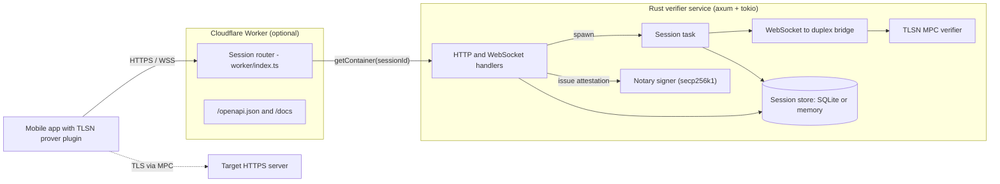

# Mobile TLSN Verifier Service

A Rust service that acts as the **verifier and notary** for TLSNotary (MPC-TLS) sessions started by a mobile prover, then issues signed attestations and verifies the resulting proof artifacts.


## Overview

[TLSNotary](https://tlsnotary.org) lets a client (the *prover*) prove that some data came from a specific HTTPS server without handing over its session keys: the TLS session keys are split between the prover and a *verifier* using multi-party computation (MPC), so neither party alone can forge traffic.

This repository is the server half of that protocol for a mobile plugin (`mobile_tlsn_plugin`, a separate client that runs the prover on-device). The service:

1. registers a verifier session with a per-session **reveal policy** (which request parts and which JSON response paths may be disclosed),
2. accepts the prover's WebSocket and runs the TLSNotary MPC verifier over it,
3. validates the prover's proposed reveal ranges against the policy,
4. signs an **attestation** over the connection data it observed during MPC, using a secp256k1 notary key, and
5. verifies exported **presentations** (selective-disclosure proofs) against its own notary key.

It ships as a single binary (`mobile-tlsn-verifier-service`) plus an optional Cloudflare Worker that gives every session a sticky, named container instance.

## Key features

- **MPC-TLS verifier** built on the upstream `tlsn` crate (tag `v0.1.0-alpha.14`), restricted to the MPC commit protocol, with per-session limits on sent/received bytes.
- **Notary attestation issuance** over the verifier-observed connection info, server ephemeral key and transcript commitments, signed with a configured secp256k1 key.
- **Policy-enforced selective disclosure**: reveal configs may only disclose the request method/target and allowlisted JSON body paths; response headers are rejected, and every allowlisted path must be revealed exactly once.
- **Artifact verification** for presentations in JSON or base64 bincode envelopes, including a trusted-notary-key check.
- **Pluggable session store**: SQLite (default) or in-memory, behind a small `SessionStore` trait.
- **Bounded lifecycles**: WebSocket handoff timeout, verifier run timeout, active-session TTL and record retention, all configurable via environment variables.
- **Edge deployment**: a Cloudflare Worker routes each session ID to its own Cloudflare Container and serves an OpenAPI schema and Swagger UI.

## Architecture



*The prover talks to the target server directly; the verifier participates in the TLS handshake and record encryption through MPC over the WebSocket. When deployed on Cloudflare, the Worker pins all traffic for one session to one container, because the live WebSocket and verifier task are process-local.*

A deeper walkthrough with sequence, state and data-model diagrams is in [docs/ARCHITECTURE.md](docs/ARCHITECTURE.md).

## Tech stack

| Area | Technology |
| --- | --- |
| Language | Rust (edition 2021) |
| HTTP / WebSocket | axum 0.7, tower-http (CORS), Tokio |
| Proof protocol | `tlsn` v0.1.0-alpha.14 (TLSNotary MPC-TLS, attestations, presentations) |
| Persistence | rusqlite 0.32 (bundled SQLite), serde_json records |
| Serialization | serde, serde_json, bincode, base64 |
| Observability | tracing, tracing-subscriber (`RUST_LOG`) |
| Edge routing | Cloudflare Workers + Containers + Durable Objects (TypeScript, Wrangler) |
| Packaging | Docker (multi-stage, `rust:1.90` builder, `debian:bookworm-slim` runtime) |
| CI/CD | GitHub Actions (Worker type-check, `cargo test --locked`, Wrangler deploy) |

## Project structure

This is a single Cargo package (not a workspace) with one binary target.

```text
.
├── Cargo.toml                 # package mobile_tlsn_verifier_service, bin mobile-tlsn-verifier-service
├── Cargo.lock
├── src/
│   ├── main.rs                # declares modules, calls app::run()
│   ├── app.rs                 # startup (env, tracing, key load, store, cleanup) and axum router
│   ├── config.rs              # env-var parsing, notary key loading, secp256k1 signer/provider
│   ├── handlers.rs            # all HTTP/WebSocket route handlers and error mapping
│   ├── types.rs               # request/response DTOs and reveal-config types
│   ├── policy.rs              # reveal policy parsing and validation, artifact payload shape checks
│   ├── session.rs             # per-session verifier task, status transitions, TTL cleanup
│   ├── state.rs               # AppState, SessionStore trait, memory and SQLite stores, records
│   ├── verifier.rs            # TLSNotary MPC verifier runtime
│   ├── ws_bridge.rs           # WebSocket frames <-> tokio duplex byte stream
│   └── artifact.rs            # proof envelope and presentation decoding
├── worker/
│   ├── index.ts               # Cloudflare Worker: session routing, /openapi.json, /docs
│   ├── openapi-schema.ts      # OpenAPI 3.0 schema served by the Worker
│   ├── wrangler.jsonc         # Worker, Container and Durable Object configuration
│   ├── package.json           # check / types / dev / deploy scripts
│   └── worker-configuration.d.ts  # generated Wrangler types
├── docs/
│   ├── API.md                 # endpoint reference
│   ├── ARCHITECTURE.md        # design deep-dive with diagrams
│   └── DEPLOYMENT.md          # Docker and Cloudflare deployment guide
├── .github/workflows/         # preview.yml (PRs) and deploy.yml (main)
├── Dockerfile                 # multi-stage release build
├── docker-compose.yml         # local container run on port 7047
├── .env.example               # all supported environment variables
├── LICENSE                    # MIT
└── THIRD_PARTY_LICENSES.md    # TLSNotary attribution
```

## Getting started

### Prerequisites

- Rust stable toolchain (`rustup`). CI uses `dtolnay/rust-toolchain@stable`; the Docker image builds with Rust 1.90.
- Network access on first build to fetch the `tlsn` Git dependency from GitHub.
- Optional: Docker, and Node.js + npm for the Cloudflare Worker.

### Install and build

```bash
git clone https://github.com/Kushal7788/plugin-service.git
cd plugin-service
cargo build            # debug build
cargo build --release  # target/release/mobile-tlsn-verifier-service
```

The first build compiles the full TLSNotary dependency tree and can take several minutes.

### Configure

```bash
cp .env.example .env
```

`NOTARY_SIGNING_KEY_B64` is **required**: the service refuses to start without a base64-encoded 32-byte secp256k1 private key. The placeholder in `.env.example` is not valid base64, so replace it. For local development, 32 random bytes are a valid key:

```bash
openssl rand -base64 32
```

Environment variables (loaded from `<crate dir>/.env`, then `./.env`, then the process environment):

| Variable | Default | Purpose |
| --- | --- | --- |
| `NOTARY_SIGNING_KEY_B64` | none (required) | Base64 32-byte secp256k1 private key used to sign attestations. Its public key is the only trusted key for artifact verification. |
| `PORT` | `7047` | Listen port; binds `0.0.0.0`. |
| `RUST_LOG` | `mobile_tlsn_verifier_service=info,tlsn=warn` | `tracing` filter. |
| `SESSION_STORE` | `sqlite` | `memory` selects the in-memory store; any other value uses SQLite. |
| `SESSION_STORE_SQLITE_PATH` | `/tmp/mobile_tlsn_verifier_sessions.sqlite3` | SQLite file; parent directories are created. |
| `SESSION_TTL_SECONDS` | `600` | Active (`pending`/`in_progress`) sessions older than this are marked `failed` during cleanup. Minimum 1. |
| `SESSION_RETENTION_SECONDS` | `3600` | Records older than this are deleted during cleanup. Clamped to at least the TTL. |
| `VERIFIER_RUN_TIMEOUT_SECONDS` | value of `SESSION_TTL_SECONDS` | Hard cap on the MPC verifier run after WebSocket handoff. |
| `WEBSOCKET_HANDOFF_TIMEOUT_SECONDS` | `60` | How long a registered session waits for the prover's WebSocket. |

### Run

```bash
cargo run
# INFO mobile tlsn verifier service listening on 0.0.0.0:7047
```

With Docker (`NOTARY_SIGNING_KEY_B64` must be set in the shell or in `.env`):

```bash
docker compose up --build
```

## Usage

Smoke-test the running service:

```bash
curl http://localhost:7047/health      # ok
curl http://localhost:7047/v1/info     # {"apiVersion":"v1","service":"mobile_tlsn_verifier_service"}
```

Register a session that may reveal only `user.name` from a JSON response:

```bash
curl -X POST http://localhost:7047/v1/sessions/register \
  -H 'Content-Type: application/json' \
  -d '{
    "clientSessionId": "debug-session-001",
    "maxRecvData": 16384,
    "maxSentData": 4096,
    "sessionData": {
      "allowedRequestHeaders": "[\"accept\"]",
      "allowedResponseBodyJsonPaths": "[\"user.name\"]"
    }
  }'
# {"sessionId":"<uuid>","verifierWsUrl":"/v1/sessions/<uuid>/verifier"}
```

The prover then opens `ws://localhost:7047/v1/sessions/<uuid>/verifier` within `WEBSOCKET_HANDOFF_TIMEOUT_SECONDS` and speaks the TLSNotary protocol over it, so the remaining steps (reveal config, attestation, presentation) are driven by the mobile plugin rather than by hand. Poll progress with:

```bash
curl http://localhost:7047/v1/sessions/<uuid>/result
```

When pointing the mobile plugin (`TransportConfig.verifierUrl`) at a local instance, use `http://10.0.2.2:7047` from the Android emulator, `http://127.0.0.1:7047` from the iOS simulator, or your machine's LAN IP from a physical device.

Every endpoint, with request/response shapes and error codes, is documented in [docs/API.md](docs/API.md).

## Testing

```bash
cargo test --locked
```

The 13 unit tests cover:

- reveal-config policy enforcement (rejecting response headers, missing, extra and duplicate JSON paths; accepting bracketed array paths),
- sanitized artifact payload shape validation,
- proof envelope parsing and presentation decode failures,
- the memory and SQLite session stores (round trip and stale-session expiry).

A full MPC session cannot be exercised with plain HTTP calls because the verifier WebSocket expects TLSNotary protocol frames; end-to-end coverage comes from running the mobile plugin's prover against a local instance. CI (`.github/workflows/`) additionally type-checks the Worker with `npm run check`.

## How it works

**Session handoff.** `POST /v1/sessions/register` parses the reveal policy from `sessionData`, persists a `SessionRecord`, stores the sending half of a `oneshot` channel in a process-local map, and spawns `run_verifier_session` holding the receiving half. When the prover's WebSocket upgrade arrives, the handler removes the sender from the map and passes the upgraded socket through the channel, so each session accepts exactly one prover connection.

**Bridging WebSocket to MPC.** The TLSN `Session` expects a byte stream, not message frames. `ws_bridge.rs` creates a 1 MiB `tokio::io::duplex` pipe: inbound binary or text frames are written into one end, and bytes read from it (in 16 KiB chunks) are sent back as binary frames. The other end is wrapped with `tokio_util::compat` and handed to `tlsn::Session`.

**Verifier run.** `verifier.rs` builds a `VerifierConfig` with the Mozilla root store (initialised once in a `OnceLock` and cloned per session), runs the commit phase, rejects any protocol other than MPC, and rejects provers whose requested `max_sent_data`/`max_recv_data` exceed the limits registered for the session. It then runs the accept, run and verify phases. The server name and transcript must be revealed to the verifier. Connection info for the attestation is recomputed from the TLS transcript by summing ciphertext lengths of `ApplicationData` records only.

**Attestation.** On completion the session stores `NotaryMaterial`: connection info, the server ephemeral key and transcript commitments, all taken from what the verifier observed. `POST /attestation` decodes the prover's bincode `AttestationRequest` and passes it to the TLSN attestation builder, which validates it against an `AttestationConfig` listing the signer's supported algorithms. The connection info, server ephemeral key and transcript commitments in the signed attestation are set from the stored `NotaryMaterial`, not from the request, and the result is signed with the configured secp256k1 key.

**Selective disclosure policy.** `policy.rs` requires at least one sent and one received range, and enforces that sent ranges disclose only `METHOD` or `REQUEST_TARGET`, received ranges disclose only `BODY` with `params.type = "json"`, every JSON path is in the allowlist, no path appears twice, and every allowlisted path is present. Start offsets must be strictly less than end offsets.

**Artifact verification.** `POST /v1/artifacts/verify` checks that the sanitized payload has a request endpoint (`method`, `host`, `path`), a positive response status, a `revealedBody` object and no response headers. It then decodes the presentation (`proof.presentation` as JSON, or `proof.presentation.bincode` as base64 bincode), confirms that its verifying key matches the public key derived from `NOTARY_SIGNING_KEY_B64`, and runs `Presentation::verify`.

**Sticky routing at the edge.** Live sessions cannot move between processes. The Worker mints the session UUID before forwarding registration, then routes `/v1/sessions/{id}/...` to `getContainer(env.VERIFIER_CONTAINER, id)`; non-session routes go to a shared `control` instance. Because every container receives the same signing key, any instance can verify artifacts signed by any other.

## Limitations and future work

- **No authentication or rate limiting.** All routes are open and CORS is fully permissive (`CorsLayer::permissive()`); deploy behind a gateway that adds both.
- **Process-local live sessions.** SQLite persists records, but an in-flight WebSocket and verifier task cannot survive a restart or be resumed elsewhere; horizontal scaling needs session affinity (as the Worker provides).
- **Single trusted notary key.** Artifact verification trusts only the key derived from this instance's signing key; there is no key rotation or multi-key allowlist.
- **`semanticVerified` mirrors `integrityVerified`.** The service checks the payload shape and the presentation signature, but does not yet cross-check `payload.response.revealedBody` against the values disclosed in the presentation.
- **Stored reveal config is not consumed elsewhere.** It is validated and persisted, and `revealConfigReceived` reports it, but attestation issuance does not depend on it; `allowedRequestHeaders` is parsed but only checked for non-emptiness.
- **Cleanup is event-driven.** Stale-session expiry and retention deletion run at startup and after each verifier task exits, not on a timer.
- **Pre-release dependency.** `tlsn` is pinned to an alpha tag, and its APIs may change between releases.
- **Testing depth.** Tests are unit-level; there is no automated end-to-end MPC test in this repository.

## Documentation

- [docs/API.md](docs/API.md): HTTP and WebSocket endpoint reference
- [docs/ARCHITECTURE.md](docs/ARCHITECTURE.md): components, request lifecycle, session state machine, data model
- [docs/DEPLOYMENT.md](docs/DEPLOYMENT.md): Docker, reverse proxy and Cloudflare Workers + Containers
- [THIRD_PARTY_LICENSES.md](THIRD_PARTY_LICENSES.md): TLSNotary licensing

## License

MIT. See [LICENSE](LICENSE). TLSNotary is used under its MIT option; see [THIRD_PARTY_LICENSES.md](THIRD_PARTY_LICENSES.md).

## Author

[Kushal7788](https://github.com/Kushal7788)
