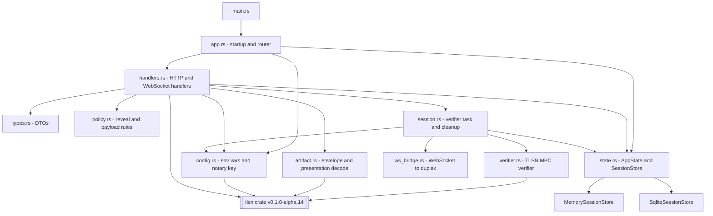
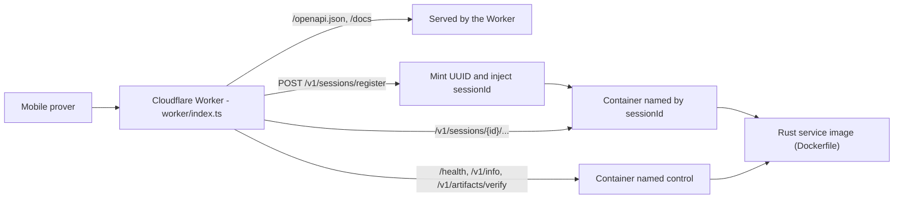
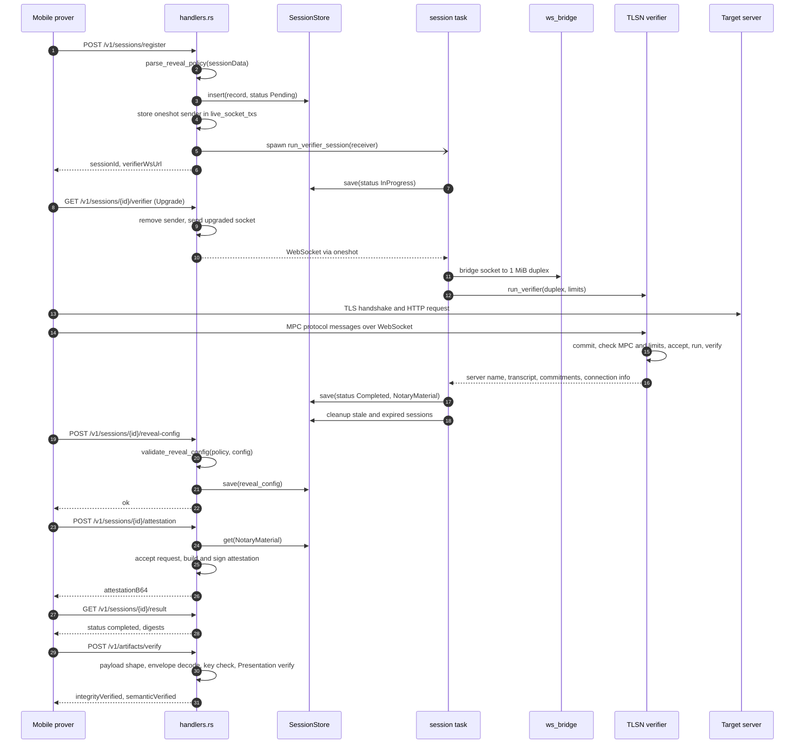
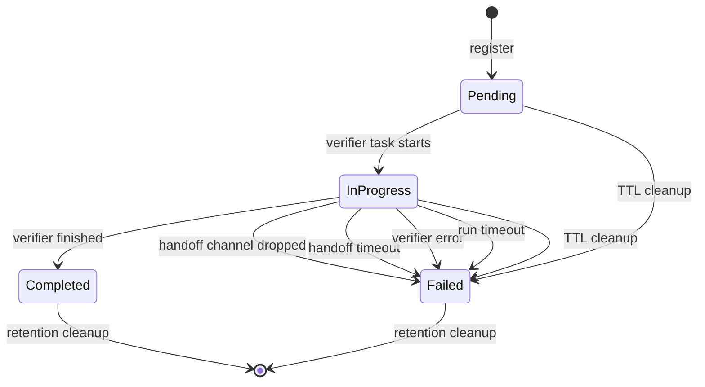
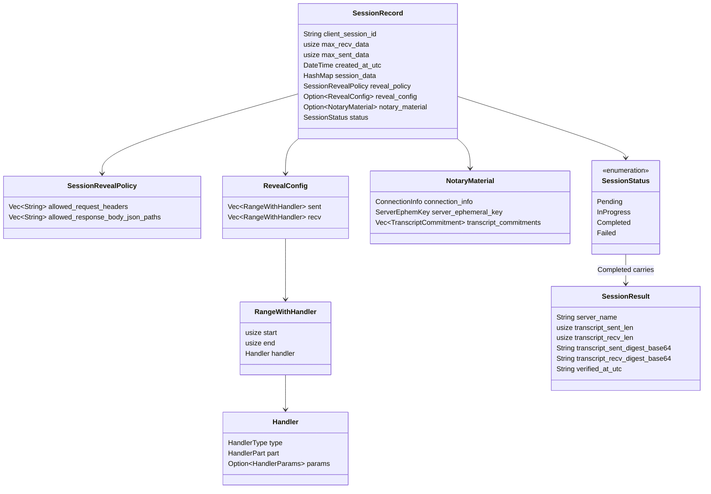
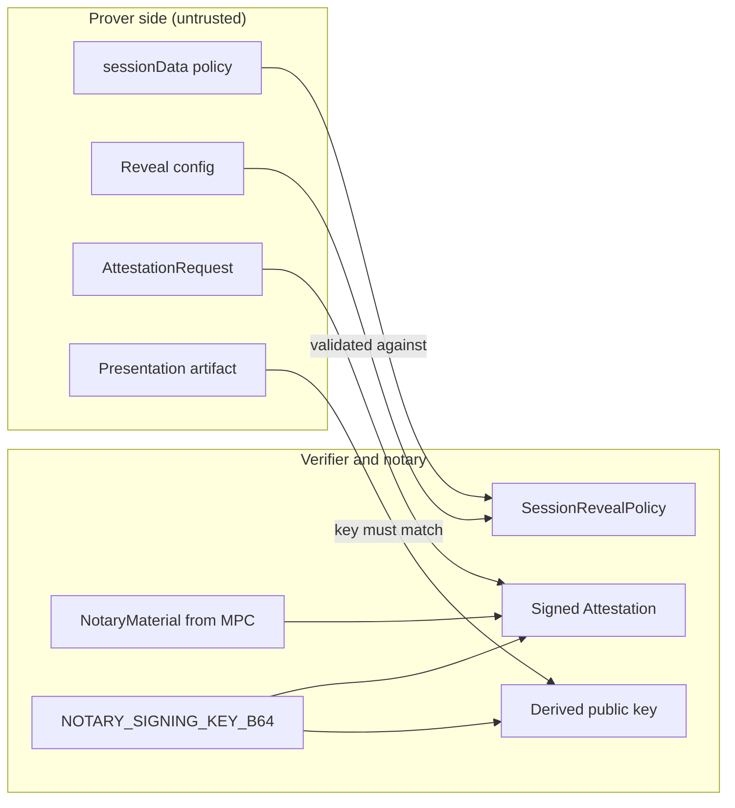

# Architecture

The service is one Rust binary built on axum and Tokio. It plays two TLSNotary roles at once: the **verifier**, which co-operates in an MPC-TLS session with a mobile prover, and the **notary**, which signs an attestation over what the verifier observed. A Cloudflare Worker can sit in front of it to give each session a dedicated container.

## 1. Module components



*Figure 1. Rust modules and their dependencies.*

`handlers.rs` is the only module that knows about HTTP. It delegates validation to `policy.rs`, proof decoding to `artifact.rs`, and long-running work to `session.rs`. `session.rs` owns the session lifecycle: it bridges the socket (`ws_bridge.rs`), drives the protocol (`verifier.rs`) and records status transitions in the store. `state.rs` defines `AppState`, which is cloned into every handler and holds:

| Field | Type | Role |
| --- | --- | --- |
| `store` | `Arc<dyn SessionStore>` | Persistent session records (SQLite or memory) |
| `live_socket_txs` | `Arc<Mutex<HashMap<String, oneshot::Sender<WebSocket>>>>` | Process-local handoff slots for prover sockets |
| `trusted_notary_keys` | `Arc<Vec<String>>` | Base64 public key derived from the signing key |
| `notary_signing_key` | `Arc<[u8; 32]>` | secp256k1 private key for attestations |

## 2. Deployment topology



*Figure 2. Request routing when deployed on Cloudflare Workers + Containers.*

The live WebSocket handoff map and the running verifier task exist only in the memory of the process that handled registration. A load balancer that spreads one session's requests across instances would break it: the WebSocket upgrade would return `409 live_session_not_available`. The Worker avoids this by choosing the container name before the request reaches Rust: it mints a UUID, injects it as `sessionId` in the registration body, and routes every later `/v1/sessions/{id}/...` request (including the WebSocket upgrade) to `getContainer(env.VERIFIER_CONTAINER, id)`. Routes without a session ID go to a shared `control` container. All containers receive the same `NOTARY_SIGNING_KEY_B64`, so the `control` instance can verify artifacts whose attestations were signed by any session container. `wrangler.jsonc` caps the deployment at 20 container instances, and `sleepAfter = "15m"` keeps a container alive past the default 10-minute session TTL.

## 3. Request lifecycle



*Figure 3. The main flow for one proof, from registration to artifact verification.*

Registration does not block on the MPC work. It records the session, creates a `oneshot` channel, and spawns a Tokio task that immediately moves the session to `in_progress` and waits up to `WEBSOCKET_HANDOFF_TIMEOUT_SECONDS` for the socket. The WebSocket handler's only job is to pass the upgraded socket through that channel. The task then runs the verifier under `VERIFIER_RUN_TIMEOUT_SECONDS`. After the session completes, the prover builds its attestation request locally, has the notary sign it, and later creates a presentation that a relying party can submit to `/v1/artifacts/verify`. The plugin also posts its reveal config, which is validated against the policy fixed at registration. The ordering of reveal-config, attestation and result calls shown here is the typical client order; the server only requires that attestation follows verifier completion.

### Verifier phases

`verifier.rs` drives the `tlsn` verifier state machine:

| Phase | What the service does |
| --- | --- |
| Setup | `Session::new(socket.compat())`, spawn the session driver, build `VerifierConfig` with the cached Mozilla root store |
| `commit()` | Receive the prover's request; reject anything other than `TlsCommitProtocolConfig::Mpc`; reject if `max_sent_data` or `max_recv_data` exceed the registered limits |
| `accept()` then `run()` | Take part in the MPC-TLS connection to the target server |
| `verify()` then `accept()` | Obtain `VerifierOutput`: server name, partial transcript, transcript commitments |
| `close()` | Close the verifier and session handle, join the driver task |
| Post-processing | Require server name and transcript; build `ConnectionInfo` using the sum of `ApplicationData` ciphertext lengths; extract the server ephemeral key |

## 4. Session state machine



*Figure 4. `SessionStatus` transitions (`src/state.rs`, `src/session.rs`).*

`Pending` is usually short-lived, because the spawned task marks the session `InProgress` before it starts waiting for the WebSocket. Failures record a human-readable message that `/result` returns as `errorMessage`. `cleanup_old_sessions` runs at startup and at the end of every verifier task. It:

1. marks `Pending`/`InProgress` sessions older than `SESSION_TTL_SECONDS` as `Failed` ("session exceeded Ns active TTL"),
2. deletes all records older than `SESSION_RETENTION_SECONDS` (never less than the TTL), and
3. prunes handoff slots whose session is gone, no longer active, or past the TTL.

Running cleanup at startup means a restarted container marks sessions it can no longer serve as failed instead of reporting them as in progress indefinitely.

## 5. Data model



*Figure 5. The session record persisted for each session.*

The whole `SessionRecord`, including the TLSN `NotaryMaterial` needed to issue an attestation later, is serialized with serde_json. The SQLite backend stores it in one table:

```sql
CREATE TABLE IF NOT EXISTS sessions (
    session_id     TEXT PRIMARY KEY NOT NULL,
    created_at_utc TEXT NOT NULL,   -- RFC 3339, used for TTL and retention cutoffs
    updated_at_utc TEXT NOT NULL,
    record_json    TEXT NOT NULL
);
CREATE INDEX IF NOT EXISTS idx_sessions_created_at_utc ON sessions(created_at_utc);
```

Both stores implement the same `SessionStore` trait (`insert`, `get`, `save`, `mark_stale_active_failed`, `delete_older_than`). Each store serializes access with a `std::sync::Mutex`: the SQLite store holds a single `rusqlite::Connection`, and the memory store holds a `HashMap`. Status, reveal policy and timestamps live inside the JSON blob, so the TTL sweep loads candidate rows by `created_at_utc` and checks their status in Rust.

## 6. Data flow and trust boundaries



*Figure 6. Which inputs come from the prover and which come from the verifier's own observations.*

The attestation's connection info, server ephemeral key and transcript commitments come from `NotaryMaterial`, which is produced by the verifier during MPC, so the prover cannot substitute them. The signing key never leaves the process, and the trusted verification key is derived from it at startup rather than configured separately. Inputs supplied by the prover (the policy strings, the reveal config, the attestation request and the presentation) are all parsed and validated before use.

## 7. Operational boundaries

- **Persistence vs. liveness.** SQLite makes session records survive restarts, but the WebSocket and verifier task do not. Container disk is instance-local, so on Cloudflare the database is per container.
- **Timeouts.** Handoff (default 60 s), verifier run (default equal to the TTL), TTL (default 600 s) and retention (default 3600 s) bound how long any session can hold resources.
- **Startup is fail-fast.** A missing or malformed `NOTARY_SIGNING_KEY_B64`, or a SQLite file that cannot be opened, panics before the listener binds.
- **Security posture.** No authentication, permissive CORS, and no rate limiting. These are expected to be handled by a gateway in front of the service.
